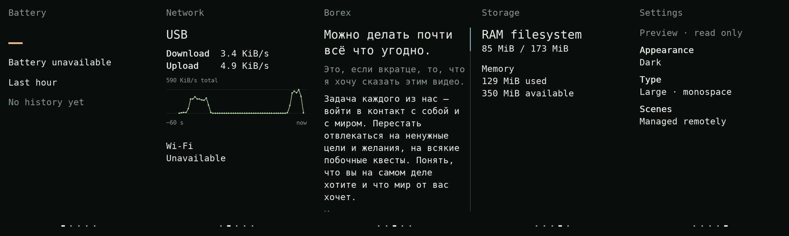

# Soy

Text scenes for the iPhone 4. Large type, a dark screen, live readings and
Markdown. AI edits an ordered scene bundle in Git and sends it over SSH;
the phone displays it independently.

Read the [design foundations](../docs/soy/foundations.md), [current design](../docs/soy/design.md)
and [Ghostty performance work](../docs/soy/performance.md) before changing it.

## Current state

The native ARM renderer runs on the real phone's 640 × 960 framebuffer.
Battery and Wi-Fi show unavailable states because their drivers are missing.
The third scene renders [Boris's Russian post](https://t.me/borex69/37).
Storage distinguishes the RAM filesystem from phone flash. Settings are read-only.

Remote and synthetic gesture controls work. The phone has no evdev input device
yet, so physical touch is not accepted. The application and its data currently
live in the RAM boot; they do not survive a reboot automatically.



Actual framebuffer captures, 20 October 2026. The image does not establish
physical touch support or animation smoothness.

## Build and inspect

```sh
make -C soy
soy/build/soy --check --assets soy/assets --scenes soy/scenes
soy/build/soy --assets soy/assets --scenes soy/scenes \
  --scene reader --render output/reader.ppm
python3 soy/tools/check_runtime.py --binary soy/build/soy --out output/soy-check
```

The check directory must be new. This launches the actual host renderer and
exercises its FIFO, pixels, gesture cancellation, scroll retention and reload.
It does not emulate the iPhone's touch controller.

Cross-build with an ARMv7 hard-float musl toolchain:

```sh
make -C soy clean
make -C soy CC=arm-linux-gcc \
  CFLAGS='-O2 -std=c11 -Wall -Wextra -Werror -march=armv7-a -mfpu=vfpv3-d16 -mfloat-abi=hard' \
  LDFLAGS=-static
```

`tools/make_fonts.py` bakes DejaVu Sans Mono masks using Pillow on the host.
The phone needs no font library. Font provenance and license are in `assets/`.
The runtime is a text scene renderer; it does not yet implement a terminal
emulator. [libghostty-vt now passes a real-phone PTY probe](ghostty/README.md);
integrating it into a visible terminal scene is the next step.

## Scene bundles

`scenes/index` lists IDs in display order. Each ID has a matching Markdown file.

```markdown
---
id: note
label: Notes
accent: sage
---
# An ordinary heading

The content belongs here.
```

Supported accents: `sage`, `cyan`, `amber`, `muted`. `hero: true` makes the first
heading suitable for a short large value. `source` records provenance.
The parser handles headings, paragraphs, emphasis, quotes, bullets, code and
link labels. It is a bounded Markdown subset, not full CommonMark. Link targets
are not opened by the current reader. Documents have a 128 KiB limit; a bundle
can contain up to 32 scenes. Long content scrolls rather than shrinking.

Read-only bindings include `battery.percent`, `battery.state`, `net.wifi`,
`net.link`, `net.rx`, `net.tx`, `storage.kind`, `storage.usage`, `memory.used`
and `memory.available`. Use `{{binding.name}}` in content.
`{{graph.battery}}` and `{{graph.network}}` draw observed history.
Scenes cannot execute shell commands.

## Deploy and control

Keep the owner SSH configuration and keys outside Git. Given that private
configuration and a cross-built binary:

```sh
python3 soy/tools/deploy.py --ssh-config PRIVATE_CONFIG \
  --binary ARM_BINARY --receipt output/deployment.json
```

The deployer stages a versioned bundle, verifies every file hash and checks
the requested scene on the phone before switching the current release.
Existing releases are verified and reused without overwriting a running ELF.
It restarts only the owned renderer, retains the prior release and attempts
rollback to the prior scene if startup fails. It never stops SSH or Tailscale.
Power-loss recovery and automatic restart after a later crash remain worker tasks.

The private `/run/soy/control` FIFO accepts one command per line:

```
next
prev
goto reader
scroll 240
reload
capture
```

`SIGHUP` also reloads scenes. Invalid bundles retain the previous scenes.
The current scene and reading position survive a valid content reload when its
ID remains. `capture` writes `/run/soy/frame.ppm`; `status.json` reports the
actual backend, input devices, frame counts and presentation timing. Debug
information stays here, off the display.

For automated checks, `touch down|move|up X Y` enters the same gesture state
machine. It is always synthetic input, never proof of physical touch.
`quit` stops the renderer cleanly.
