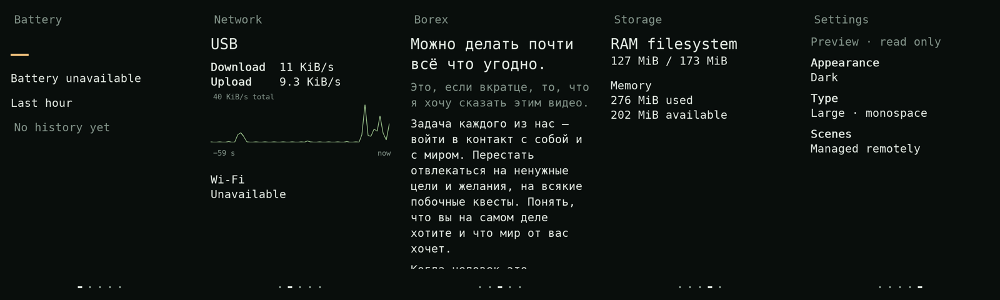

# Soy

Text scenes for the iPhone 4. Large type, a dark screen, live readings and
Markdown. AI writes a scene and `tools/scene.py` publishes it to the running
phone; the phone displays it independently. [Writing scenes](../docs/soy/scenes.md)
has the format and the commands.

Read the [design foundations](../docs/soy/foundations.md), [current design](../docs/soy/design.md)
and [Ghostty performance work](../docs/soy/performance.md) before changing it.

## Current state

The native ARM renderer runs on the real phone's 640 × 960 framebuffer.
Battery and Wi-Fi show unavailable states because their drivers are missing.
The third scene renders [Boris's Russian post](https://t.me/borex69/37).
Storage distinguishes the RAM filesystem from phone flash. Settings are read-only.

The touch frontend uses pinned LVGL 9.6.0 for scrolling, snapping, gestures and
layout, with pinned Pixman 0.46.4 for basic composition and pinch scaling.
It currently **fails the 60 fps release requirement** by one or two frames on
five of six surfaces; see the measured results in [performance.md](../docs/soy/performance.md).
[The research and interaction map](../docs/soy/touch-research.md) explain the
choice. Physical touch arrives from the N1 controller through
`kernel/n90-touch`; acceptance tests replay virtual contacts through uinput.
The phone runs from RAM. After every reboot the boot harness reinstalls Soy
with the last published scenes.



LVGL scenes read independently from the phone's active KMS buffer,
21 October 2026, shown at 320 × 480 logical size. Native 640 × 960 images
were also inspected. These still images do not prove physical touch or
animation smoothness. [Results and artifact hashes](../docs/soy/touch-results.json)
record the checks and remaining failures.

## Build and inspect

```sh
python3 soy/tools/build_touch.py --target native
output/soy/lvgl-native/soy --check --assets soy/assets --scenes soy/scenes
output/soy/lvgl-native/soy --assets soy/assets --scenes soy/scenes \
  --scene reader --render output/reader.ppm
python3 soy/tools/build_touch.py --sanitize
python3 soy/tools/check_scene_boundary.py \
  --binary output/soy/lvgl-native-asan/soy --out output/soy-boundary-check
```

The output directory for a check must be new. The source download is pinned by
revision and SHA-256. CMake, Meson, Ninja and a C/C++ compiler are needed on
the host. `--build-tools /PATH/TO/buildroot/host/bin` can use the existing
Buildroot Meson/Ninja installation for a native build. No
desktop toolkit, window server or runtime dependency is installed on the phone.

Cross-build with the existing ARMv7 hard-float musl toolchain:

```sh
python3 soy/tools/build_touch.py --target armv7 --toolchain /PATH/TO/toolchain/bin
```

The ARM build enables Cortex-A8 NEON. Immutable paragraphs use LVGL snapshots,
with a 128 MiB global pixel-cache budget. Bounded immutable documents prepare
the five font layouts before the first frame; pinch release switches layouts
around the same reading anchor. Larger or live documents still use synchronous
reflow and must not be called performance-complete. Pixman draws the clipped
nearest-neighbour pinch preview into LVGL's buffer. Simpledrm receives damage
copies directly; this does not establish synchronized panel scanout. Pages
and panels reuse viewport images during movement. The panel backdrop is
dimmed once on opening; live controls resume at rest. `make -C soy legacy` retains the
previous renderer for recovery; do not confuse its FIFO gesture checks with
the new kernel input checks.

Input readiness wakes LVGL without waiting for another polling tick.
Independent telemetry reads are staggered while retaining one-second sampling.
The [Opus 5.5 review](../docs/soy/review-2026-10-21.md) records these decisions
and the remaining cold-start, live-update and display-copy work.

## Idle display

The LVGL runtime blanks after **60 seconds without interaction**. Contacts and
scrolling keep it awake; telemetry, scene reloads and diagnostic captures do
not. Blanking pauses rendering and retains the current scene, type size and
reading position. The first waking contact is consumed until every finger
lifts. Remote navigation also wakes the display. SSH and Tailscale are separate
processes and the system is never suspended.

Blanking draws black pixels, then turns the PMU backlight off when the kernel
has the `pmu-backlight` device (`kernel/n90-display-power`). A touch or remote
navigation wakes it. [Evidence and remaining hardware work](../docs/soy/idle-display.md).

The private `/run/soy/control` FIFO accepts `sleep`, `wake`, and `idle SECONDS`
(0 disables automatic blanking, maximum 86400). For example, over the existing
private SSH connection:

```sh
printf 'wake\n' > /run/soy/control
printf 'idle 120\n' > /run/soy/control
```

Set `--idle-seconds 120` at process startup to change the default. FIFO changes
last until that process exits. `/run/soy/status.json` reports `display_state`
(`awake` or `blanked`), `idle_timeout_s`, `inactive_ms`, and `backlight`
(`on`, `off` or `unavailable`). The old fallback renderer is unchanged.

```sh
python3 soy/tools/check_idle.py --binary output/soy/lvgl-native-asan/soy \
  --out output/soy-idle-check
```

`tools/make_fonts.py` bakes DejaVu Sans Mono masks using Pillow on the host.
The phone needs no font library. Font provenance and license are in `assets/`.
The runtime is a text scene renderer; it does not yet implement a terminal
emulator. [libghostty-vt now passes a real-phone PTY probe](ghostty/README.md);
integrating it into a visible terminal scene is the next step.

## Scene bundles

`scenes/` holds the default scenes; the published ones live in the private
scene library ([Writing scenes](../docs/soy/scenes.md)). An `index` lists IDs
in display order. Each ID has a matching Markdown file.

```markdown
---
id: note
label: Notes
accent: sage
---
# An ordinary heading

The content belongs here.
```

Supported accents: `sage`, `cyan`, `amber`, `muted`. `hero: true` makes the first
heading suitable for a short large value. `source` records provenance.
The parser handles headings, paragraphs, emphasis, quotes, bullets, code and
link labels. It is a bounded Markdown subset, not full CommonMark. Link targets
are not opened by the current reader. Documents have a 128 KiB and 2,048-line limit; a bundle
can contain up to 32 scenes. Long content scrolls rather than shrinking.

Read-only bindings include `battery.percent`, `battery.state`, `net.wifi`,
`net.link`, `net.rx`, `net.tx`, `storage.kind`, `storage.usage`, `memory.used`
and `memory.available`. Use `{{binding.name}}` in content.
`{{graph.battery}}` and `{{graph.network}}` draw observed history.
Scenes cannot execute shell commands.

## Deploy and control

Keep the owner SSH configuration and keys outside Git. Given that private
configuration and a cross-built binary:

```sh
python3 soy/tools/deploy.py --ssh-config PRIVATE_CONFIG \
  --binary ARM_BINARY --receipt output/deployment.json
```

The deployer installs a new renderer build. Scene changes don't need it:
`tools/scene.py` publishes them into the running renderer. The deployer stages
a versioned bundle (`--scenes` picks the bundle), verifies every file hash and
checks the requested scene on the phone before switching the current release.
Existing releases are verified and reused without overwriting a running ELF.
It restarts only the owned renderer, retains the prior release and attempts
rollback to the prior scene if startup fails. It never stops SSH or Tailscale.
After a later crash the phone's keep supervisor (`kernel/n90-keep`) restarts
the renderer on the same scene, and goes back to the prior release if it keeps
crashing.

The private `/run/soy/control` FIFO accepts one command per line:

```
next
prev
goto reader
scroll 240
reload
capture
trace
```

`SIGHUP` also reloads scenes. Invalid bundles retain the previous scenes.
The current scene and reading position survive a valid content reload when its
ID remains. `capture` writes `/run/soy/frame.ppm`; `status.json` reports the
actual backend, physical versus virtual inputs, gesture state, cache size and
complete LVGL rendering plus framebuffer-transfer timings. `trace` writes the bounded `/run/soy/frames.csv` history. Debug information
stays here, off the display. `display_capture.c` independently reads the active
KMS buffer; `/dev/fb0` may refer to an older buffer during direct DRM use.

`quit` stops the renderer cleanly. The new frontend deliberately has no
high-level fake-touch FIFO command. Unattended acceptance uses `touch_replay.c`
through `/dev/uinput`, then the same evdev and LVGL path a hardware driver uses:

```sh
arm-linux-gcc -O2 -static soy/tools/touch_replay.c -o output/touch-replay-arm
python3 soy/tools/check_touch.py --ssh-config PRIVATE_CONFIG \
  --replay output/touch-replay-arm --out output/phone-touch-check
```

The phone needs its matching `uinput.ko` loaded. Replay devices are named
`Soy replay (virtual)`, use a different coordinate range from the LCD, and are
destroyed when the replay process exits. No test result establishes physical
finger support. Device disappearance and event overflow cancel the current
gesture; input resumes after contacts are released.

Measure all four moving surfaces on the phone:

```sh
python3 soy/tools/check_frames.py --ssh-config PRIVATE_CONFIG \
  --replay output/touch-replay-arm --out output/phone-frames-reading \
  --surface reading
```

Repeat for `pages`, `pinch` and `sheet`. The script deliberately exits nonzero
when any interval exceeds 16.67 ms. Preserve the failure and raw trace; averages
and timer settings cannot replace the release gate.
